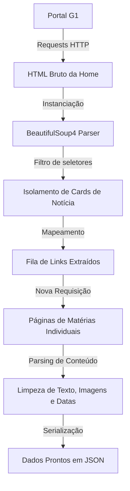

<div align="center">

# G1 API Unofficial

Notícias do G1 coletadas, estruturadas e organizadas com Python.


[](https://www.python.org/)
[](https://requests.readthedocs.io/)
[](https://www.crummy.com/software/BeautifulSoup/bs4/doc/)
[](https://github.com/nunogues/g1api-unofficial)

Uma API não oficial em desenvolvimento para coletar e estruturar notícias do portal G1.

[Repositório](https://github.com/nunogues/g1api-unofficial) · [Reportar um problema](https://github.com/nunogues/g1api-unofficial/issues)

</div>

---

## 📌 Sobre o Projeto

O **G1 API Unofficial** é uma biblioteca desenvolvida em Python voltada para fazer web scraping do portal de notícias [G1](https://g1.globo.com/). O objetivo principal é transformar páginas HTML instáveis em dados estruturados legíveis por máquinas. 

Dessa forma, fica muito mais fácil integrar informações em tempo real do G1 a bots do Telegram/Discord, dashboards de monitoramento, pipelines de dados ou sistemas automatizados.

## ✨ Funcionalidades

- [x] Realizar requisições HTTP seguras e otimizadas ao portal G1.
- [x] Mapear e parsear o HTML utilizando BeautifulSoup4.
- [x] Capturar e isolar os blocos de notícias direto da página inicial.
- [ ] Extrair links das matérias em destaque de forma dinâmica.
- [ ] Crawlear páginas individuais de notícias de maneira assíncrona/sequencial.
- [ ] Extrair metadados refinados (títulos, imagens de capa, data de publicação e corpo de texto).
- [ ] Formatar o payload final das respostas inteiramente em JSON estruturado.
- [ ] Expor endpoints locais por meio de uma API HTTP integrada (FastAPI/Flask).
- [ ] Implementar políticas robustas de retentativas, tratamento de erros e timeouts.

> ⚠️ **Nota:** O projeto encontra-se em fase de desenvolvimento ativo. Os itens desmarcados representam o Roadmap do projeto e serão implementados gradativamente.

## 🛠️ Tecnologias Utilizadas

| Tecnologia | Finalidade |
| :--- | :--- |
| **[Python](https://www.python.org/)** | Linguagem de programação core do projeto. |
| **[Requests](https://requests.readthedocs.io/)** | Cliente HTTP para buscar páginas Web e contornar bloqueios simples de rede. |
| **[BeautifulSoup4](https://www.crummy.com/software/BeautifulSoup/bs4/doc/)** | Extração, navegação e manipulação fina da árvore de elementos DOM HTML. |

## 📐 Como Funciona a Arquitetura

O fluxo lógico de extração foi idealizado para isolar responsabilidades e garantir que mudanças no layout do portal G1 afetem o menor número de módulos possível:



## 🚀 Instalação e Configuração

Certifique-se de ter o Python 3.8+ instalado em sua máquina.

1. **Clone o repositório:**
   ```bash
   git clone https://github.com/nunogues/g1api-unofficial.git
   ```

2. **Acesse o diretório do projeto:**
   ```bash
   cd g1api-unofficial
   ```

3. **Instale as dependências obrigatórias:**
   ```bash
   pip install -r requirements.txt
   ```
   *(Ou instale manualmente via: `pip install requests beautifulsoup4`)*

## 💻 Exemplo Prático de Uso

O script abaixo mostra uma demonstração simples de como capturar os cabeçalhos principais (`<h2>`) renderizados no feed principal do portal G1:

```python
import requests
from bs4 import BeautifulSoup

def fetch_g1_headlines():
    url = "https://g1.globo.com/"
    headers = {
        "User-Agent": "Mozilla/5.0 (Windows NT 10.0; Win64; x64) AppleWebKit/537.36 (KHTML, like Gecko) Chrome/120.0.0.0 Safari/537.36"
    }

    try:
        # Requisição com timeout de segurança configurado
        response = requests.get(url, headers=headers, timeout=10)
        response.raise_for_status()
        
        soup = BeautifulSoup(response.text, "html.parser")
        
        print("=== Manchetes Encontradas na Home ===")
        for heading in soup.find_all("h2"):
            title = heading.get_text(" ", strip=True)
            if title:
                print(f"📌 {title}")
                
    except requests.exceptions.RequestException as e:
        print(f"Erro ao acessar o portal G1: {e}")

if __name__ == "__main__":
    fetch_g1_headlines()
```

> 💡 **Informação Importante:** Este snippet é um protótipo didático para testes locais. Ele captura todos os seletores HTML correspondentes na página atual e não valida se o texto recuperado se trata de uma notícia factual ou de um link interno.

## 📊 Estrutura dos Dados Obtidos (Schema Alvo)

Após a normalização, o formato padrão de payload retornado pelas consultas internas seguirá rigorosamente este modelo JSON estruturado:

```json
{
  "title": "Título limpo e formatado extraído da matéria",
  "url": "https://globo.com",
  "image": "https://glbimg.com",
  "published_at": "2026-10-24T17:09:00Z",
  "content": "Corpo completo da matéria textual estruturada e limpa sem tags HTML residuais."
}
```

## ⚖️ Isenção de Responsabilidade (Disclaimer)

* Este projeto possui fins estritamente acadêmicos, didáticos e de estudo sobre engenharia de dados e Web Scraping.
* Não possui qualquer afiliação oficial, patrocínio ou suporte legal do Grupo Globo ou do portal G1 de Notícias.
* Certifique-se de usar este software de forma consciente e respeitosa, mantendo taxas de requisições toleráveis para evitar sobrecarga (DoS) nas plataformas de origem de acordo com as diretrizes do arquivo `robots.txt` do domínio correspondente.

## 👤 Autor

Desenvolvido por **[@nunogues](https://github.com/nunogues)**. Se o projeto te ajudou ou foi útil de alguma maneira, sinta-se à vontade para deixar uma 🌟 no repositório!

---
<div align="center">

Construído com 🐍 Python para fins de aprendizado, automação e exploração de dados livres.

</div>
