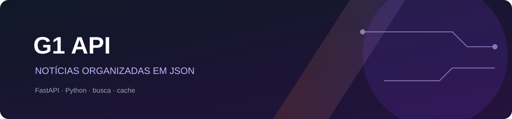

<p align="center">
  
</p>

<div align="center">

**An unofficial REST API that turns G1 headlines into clean, structured JSON.**


[Live API](https://g1api-unofficial.onrender.com/) · [Documentation](https://g1api-unofficial.onrender.com/docs) · [Try it](https://g1api-unofficial.onrender.com/news?limit=5)

</div>

---

## Features

- Fetches the latest news from the G1 homepage.
- Searches cached headlines and summaries.
- Includes publication metadata and image URLs when available.
- Uses an in-memory cache with a 60-second TTL.
- Provides interactive API documentation through FastAPI.
- Validates query parameters.

## Quick start

Try the deployed API:

```bash
curl "https://g1api-unofficial.onrender.com/news?limit=5"
curl "https://g1api-unofficial.onrender.com/news/search?q=tecnologia"
```

## Endpoints

| Method | Endpoint | Description |
|---|---|---|
| GET | `/` | API information |
| GET | `/health` | Health check |
| GET | `/news` | Retrieve cached news |
| GET | `/news/search` | Search cached news |
| GET | `/docs` | Interactive documentation |

### GET /news

| Parameter | Type | Default | Constraints |
|---|---|---:|---|
| `limit` | integer | 10 | 1–20 |

[Try /news](https://g1api-unofficial.onrender.com/news?limit=5)

### GET /news/search

| Parameter | Type | Description |
|---|---|---|
| `q` | string | Search term |
| `limit` | integer | Maximum results (1–20; default 10) |

[Try search](https://g1api-unofficial.onrender.com/news/search?q=tecnologia)

> [!NOTE]
> Search runs only against the news currently in the API cache. It does not search the full G1 archive.

## Run locally

```bash
git clone https://github.com/nunogues/g1api-unofficial.git
cd g1api-unofficial
pip install -r requirements.txt
uvicorn app.main:app --reload
```

Open `http://127.0.0.1:8000/docs` to explore the API.

## Tech stack

- Python
- FastAPI
- Requests
- Beautiful Soup
- Pydantic

## Caching and limitations

The in-memory cache uses a 60-second TTL. It resets when the application restarts and is not shared between separate server processes.

- Data extraction depends on G1's public website structure and available metadata.
- The API may return fewer items than requested.
- Full article text is not provided.
- Availability depends on the hosting provider and the source website.

## Disclaimer

This is an independent, unofficial project and is not affiliated with, endorsed by, or sponsored by G1 or Grupo Globo. News content and trademarks belong to their respective owners.

---

<p align="center"><sub>Built to explore web scraping, REST API development, caching, and deployment.</sub></p>
